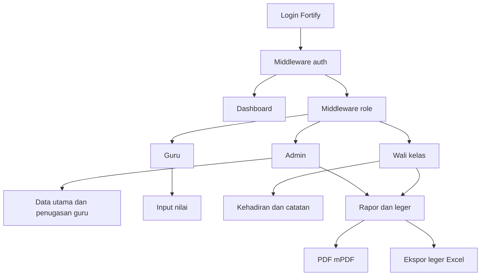

# Peta Fitur Rapor PPSR

Kembali ke [[Beranda Rapor PPSR]]. Hubungan data dijelaskan di [[Relasi Data Rapor PPSR]].

## Jalur request

## Lokasi fitur

| Fitur | Implementasi |
| --- | --- |
| Rute dan pembagian akses | `routes/web.php`, `app/Http/Middleware/RoleMiddleware.php` |
| Dashboard | `app/Livewire/Dashboard.php` |
| Tahun ajaran, kelas, siswa, guru, mata pelajaran | `app/Livewire/Admin/` |
| Penugasan guru menurut tingkat | `app/Livewire/Admin/PenugasanGuru/` |
| Input nilai guru | `app/Livewire/Guru/InputNilai/` |
| Kehadiran dan catatan wali kelas | `app/Livewire/WaliKelas/Kehadiran/`, `app/Livewire/WaliKelas/Catatan/` |
| Rapor admin dan wali kelas | `app/Livewire/Admin/Rapor/`, `app/Livewire/WaliKelas/Rapor/` |
| Leger admin dan wali kelas | `app/Livewire/Admin/LegerKelas/`, `app/Livewire/WaliKelas/LegerKelas/` |
| Ekspor leger | `app/Exports/LegerKelasExport.php` |
| Pengaturan rapor | `app/Livewire/Admin/RaporSettings/Edit.php` |
| Tampilan halaman dan cetak | `resources/views/livewire/` |

## Detail guru

Rute `admin.guru.view` membuka `app/Livewire/Admin/Guru/View.php` dan tampilan `resources/views/livewire/admin/guru/view.blade.php`.

Detail mencakup identitas, kontak, kepegawaian, username, dan role. Query detail membatasi `sekolah_id` sesuai admin yang login. Password tidak ditampilkan; usulan penyimpanan password yang dapat dibuka kembali dibatalkan pengguna.

## Batas akses

Grup admin menggunakan `role:admin`. Grup guru dan wali kelas sama-sama mengizinkan role `guru` dan `wali_kelas` di tingkat rute. Pembatasan terhadap kelas atau siswa tertentu perlu ditelusuri di masing-masing komponen; pembagian grup rute saja belum membuktikan seluruh otorisasi data.
